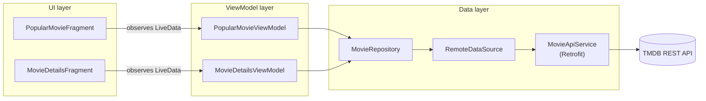

<div align="center">

# 🎬 My Movie App

**An Android app that browses today's popular movies from TMDB, built with Kotlin and MVVM.**


</div>

---

## 📌 Overview

**My Movie App** fetches the list of popular movies from [The Movie Database (TMDB) API](https://developer.themoviedb.org/)
and shows them in a poster grid. Scrolling to the bottom loads the next page automatically, and tapping a poster
opens a detail screen with the movie's tagline, release date and overview.

I built it to practice a clean, layered Android architecture: the UI never talks to the network directly,
every request goes through a ViewModel → Repository → Data Source chain, and each screen reacts to a single
`Resource` state (Loading / Success / Error).

<!--
📸 SCREENSHOTS — add them here, it makes a big difference to reviewers.
1. Run the app, take screenshots of the movie grid and the detail screen.
2. Put them in a folder named  screenshots/  in this repository.
3. Delete this comment block and uncomment the table below.

| Popular movies | Movie details |
|:-:|:-:|
|  |  |
-->

## ✨ Features

- 🎞️ **Popular movies grid** — 3-column poster grid loaded from TMDB's `/movie/popular` endpoint
- ♾️ **Infinite scroll** — a `RecyclerView` scroll listener requests the next page when you reach the end
- 📄 **Movie details** — poster, title, tagline, release date and overview from `/movie/{id}`
- ⏳ **Loading & error states** — a loader dialog while requests run, clear messages on network or parsing failures
- 🧭 **Type-safe navigation** — Navigation Component with Safe Args passes the selected movie as a `Parcelable`
- ⚡ **Efficient list updates** — `DiffUtil` updates only the posters that changed

## 🏗️ Architecture

The app follows **MVVM with the Repository pattern**. Each layer only knows about the layer below it.



**How a request flows**

1. The fragment asks its ViewModel for data.
2. The ViewModel launches a coroutine in `viewModelScope` and posts `Resource.Loading`.
3. The repository forwards the call to the remote data source, which calls Retrofit.
4. The response is wrapped as `Resource.Success` (new pages are appended to the existing list) or `Resource.Error`.
5. The fragment observes the `LiveData` and shows the grid, the loader or an error message.

## 🧰 Tech stack

| Area | Library / tool |
|:--|:--|
| Language | Kotlin |
| Architecture | MVVM, Repository pattern, `Resource` sealed class for UI state |
| Async | Kotlin Coroutines (`suspend` Retrofit calls, `viewModelScope`) |
| Networking | Retrofit 2, Gson converter, OkHttp with a logging interceptor |
| UI | Fragments, RecyclerView + `GridLayoutManager`, Material Components, ConstraintLayout |
| Binding | View Binding & Data Binding |
| Navigation | Jetpack Navigation Component + Safe Args |
| Images | Glide |
| Lifecycle | ViewModel, LiveData |

## 📂 Project structure

```
app/src/main/java/com/example/mymovieapp/
├── data/
│   ├── api/            # Retrofit client and TMDB endpoints
│   ├── common/         # Resource state wrapper, exception handling
│   ├── model/          # Movie, MovieResponse, MovieDetails
│   ├── remotesource/   # RemoteDataSource interface + implementation
│   └── repository/     # MovieRepository interface + implementation
├── ui/
│   ├── adapter/        # MovieAdapter, DiffUtil callback, click listener
│   ├── popularmovies/  # grid screen: Fragment + ViewModel
│   └── moviedetails/   # detail screen: Fragment + ViewModel
├── utils/              # constants, binding adapters, loader dialog
└── MainActivity.kt     # single activity hosting the navigation graph
```

## 🚀 Getting started

**Requirements:** Android Studio (Chipmunk or newer), JDK 11, an Android device or emulator running Android 6.0+.

1. **Clone the repository**
   ```bash
   git clone https://github.com/Monira-Meem/MovieApp.git
   ```
2. **Get a free TMDB API key** at [themoviedb.org → Settings → API](https://www.themoviedb.org/settings/api).
3. **Add the key to `local.properties`** in the project root (this file is git-ignored, so your key stays private):
   ```properties
   TMDB_API_KEY=your_api_key_here
   ```
4. **Open the project in Android Studio**, let Gradle sync, then press **Run ▶**.

## 🛣️ Roadmap

Ideas I would add next to take this further:

- [ ] Dependency injection with Hilt
- [ ] Offline cache with Room
- [ ] Movie search and genre filters
- [ ] Unit tests for ViewModels and the repository
- [ ] Migrate the UI to Jetpack Compose

## 🙏 Acknowledgements

Movie data and images are provided by [TMDB](https://www.themoviedb.org/).
This product uses the TMDB API but is not endorsed or certified by TMDB.

---

<div align="center">

Made by **[Monira Meem](https://github.com/Monira-Meem)** · Final-year B.Sc. Computer Science & Technology, Wuhan Institute of Technology

</div>
